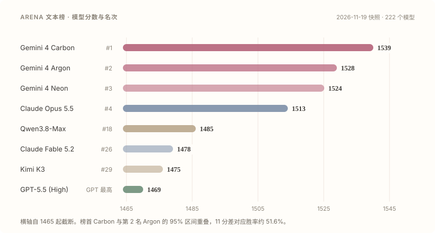
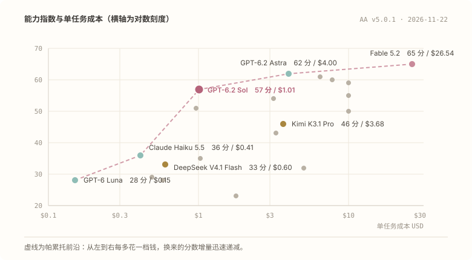

模型评测常被简化成一个问题：哪个模型最强。这个问题在 2026 年已经很难有单一答案。同一时期，Claude Fable 5.2 在 Artificial Analysis 的 Intelligence Index 上以 65 分位列第一，在 Arena 文本榜上却以 1478 分排第 26，落后榜首 61 分。两个数字都不算错，它们测量的是不同的对象。

本文先界定模型评测的对象与数据来源，再逐家对照 Claude、OpenAI、Google、DeepSeek 最新模型的发布数据与实际表现，最后给出当前的能力分布与性价比判断。

## 一、模型评测的对象

模型评测至少包含三类互不替代的对象。

| 对象 | 测量方式 | 能回答的问题 | 主要失效方式 |
| --- | --- | --- | --- |
| 能力 | 静态基准，固定题库 | 覆盖范围内答对多少 | 饱和、污染、题型偏离真实任务 |
| 偏好 | 成对盲投，BT 拟合 | 短期回答里人类偏好哪个 | 长度与格式偏差、投票者与使用者不同 |
| 可靠性 | 端到端任务，查系统状态 | 能否把一件事完整交付 | 任务构造偏向出题方的产品形态 |

三者量纲不通约：能力分是指数或百分比，偏好分是 Bradley-Terry 系数，可靠性是相对基线的净提升。能力可以复现，但只在题型覆盖范围内有效；偏好反映表达方式与答案风格的综合印象，不是解题正确率；可靠性关心能否交付，一个把代码写对却落到错误分支的 agent，在能力测试里拿分，在可靠性测试里失败。把三种数字放进同一张表排名，问题出在起点，不在数值。

名次本身还依赖统计前提。Arena 自 2024 年 1 月起改用全量 BT 拟合，媒体所说的「Elo 分」实为 BT 系数，分差与胜率的换算如下。

| 分差 | 高者的胜率 |
| --- | --- |
| 10 | 51.4% |
| 50 | 57.1% |
| 100 | 64.0% |

榜单上两个模型相差十几分，落在置信区间内时不足以支撑排名叙事。

数据来源分三层，各自回答不同的问题：厂商自报用于确认代际提升与配置口径，独立第三方用于确认自报值是否偏离，自己的任务集用于确认这笔钱值不值。第三层最常被跳过，而它恰好是唯一能回答「换成我的任务会怎样」的证据——厂商测的是平均分，用户用的是长尾。所以自建集是绕不开的，最小做法三件事。

1. **建金标集。** 从调用日志里抽 50 至 200 条真实请求，人工标注可判定的期望结果。不必追求覆盖，追求能分出对错，且每次运行都是同一批样本。
2. **统一成本口径。** 分子取全口径支出（input、output、缓存、重试），分母取金标集上的成功率，得到 cost per success，不用 token 单价代替。
3. **接进回归。** 改提示词、换档位、换模型都跑一遍，看通过率有没有掉，而不是平均分有没有涨。

样本量少于 100 时通过率区间宽到无法支撑结论，60% 与 70% 在 50 条样本上分不出高下；agent 任务的重试成本常使实际支出达到单次调用的 2 至 5 倍，不计入就会低估。

## 二、主要模型的发布数据与实际表现

2026 年的发布页有一套共同的论证结构：与上一代对比、与竞品对比、在同等性能下强调成本优势。差异全在选哪张考卷、报哪几行、拿什么当成本。

### 2.1 Claude：八行表与主动标注的短板

Anthropic 在 Opus 5.5（9 月 22 日）的发布页给出了八行对比数据，同时列出厂内前代与厂外竞品。

| 基准 | Opus 5.5 | Fable 5.1 | Opus 5 | GPT-6 Astra |
| --- | --- | --- | --- | --- |
| Terminal-Bench 4.0 | **66.4%** | 55.8 | 52.3 | 57.9 |
| FrontierCode v1.1 | **54.4%** | 50.3 | 48.0 | 53.3 |
| CursorBench 4.0 | **57.8%** | 51.8 | 46.6 | 未报 |
| GDPval-AA v2.1 | **1846** | 1735 | 1708 | 1542 |
| AutomationBench | 40.0 | 31.4 | 26.9 | **41.4** |
| HLE（with tools） | **67.7%** | 65.6 | 63.6 | 57.2 |
| Terminal-Bench-Science 0.1 | 58.7 | 52.6 | 29.0 | **64.6** |
| OSWorld 2.0（partial） | **81.8%** | 80.7 | 74.0 | 未报 |

八行中有两行落后，仍被完整列出。这份表的证明力来自标注而非分数，其中三处标注承担了关键作用：竞品一列注明「数据取自 OpenAI 自报」，即跨厂那一列不是自己跑的；正文承认「标准误约 2.6 点，在当下能力水平 benchmark margin 已不太可靠」；脚注说明生产环境的 safeguards 会压低自己的分数，cyber 类任务被回退到 Opus 4.8。

CursorBench 4.0 这一行另有细节。同一模型在 max 档是 57.8%、$13.43 每任务，在 high 档是 56.0%、$3.97——降一档丢 1.8 分，省 70% 的成本。这类数字不会出现在发布页的正文里，只出现在基准方的排行榜上。

同页还有一处未解释的矛盾：Opus 5.5 在 Terminal-Bench 4.0 上以 66.4% 对 57.9% 领先 8.5 分，正文却表述为两者「matches」。这类矛盾通常意味着两列数据并非同一 harness 产出。

### 2.2 OpenAI：以自建基准为主，成本并排列

GPT-6.2 Astra（11 月 17 日）的发布页没有把学术基准当作主论据，而是集中在四类任务上，每一项都附成本。

- **Agents' Last Exam v1.1**：78.3%，同格标注 $2.89 每任务；同表中 Fable 5.2 为 78.8%，成本 $60.05。两者分数相差 0.5 分，成本相差约 21 倍——这是把「同等能力下更便宜」写进同一行的做法。
- **GDPval v2**：自家内部基准，比上一代提升 6.2 个百分点，output token 少用 22%。
- **Harvey LAB-AA v1.1**（法律）：通过率约为 Fable 5.2 的两倍，成本约六分之一。
- **FrontierMath Erdős**：68 道未解数学题解出 7 道，经 Lean 形式化验证，前纪录为 3/68。

通用能力上报了 GPQA Diamond 94.8%、SWE-Bench Pro 49.3%，另有 AA-3D 1318 Elo（人类盲评交互体验），并自称「最适合科学家的模型」。选卷范围与产品定位一致：长程专业任务、法律交付、未解数学、科研工作流。对应地，Terminal-Bench 4.0 与 OSWorld 未出现在表中——前者在这一项落后 Opus 5.5 8.5 分，后者是对方的赢面。

成本列的位置本身也在传递信息。把 $2.89 与 $60.05 并排，读者会自然得出「性价比更高」的结论，但这两个数来自同一 harness 下的单任务测量，而分数只差 0.5 分，本身落在标准误之内。成本差是真的，能力差在统计上不成立。

### 2.3 Google：只报三项第一，成本作为并列条件

Gemini 4 Carbon（10 月 28 日预告，11 月 10 日正式可用）的发布页只强调三个第一名：CursorBench 4.0、Perplexity WANDR、Zapier AutomationBench，每一项后都注明「单任务成本比次优外部模型低一半以上」。对应的数值是 CursorBench 60.4%、AutomationBench 53.88%、WANDR 0.857（soft F1），前两项分别高于 Opus 5.5 的 57.8% 与 40.0%。

推理类报的是 ARC-AGI 98.5%、ARC-AGI-2 94.2%、GPQA 96.5%、AIME 100%、SimpleBench 92.6%。

这三个基准的出题方分别是 Cursor、Perplexity 与 Zapier，都是产品公司为自己的业务场景设计的考卷：IDE 考意图推断，研究型 agent 考证据覆盖，工作流 agent 考落库状态。Carbon 在这三项上领先，说明它在「工具调用 + 多步执行」这条线上占优；但在 Terminal-Bench 4.0、HLE、SWE-bench 这些另两家主打的项上，发布页没有给出数字。

Carbon 还是受限发布，仅向网络安全防御方开放。这一点在解读它的榜单位置时必须计入，原因见 2.5。

### 2.4 DeepSeek：小模型打上一代旗舰，通用知识仍有差距

DeepSeek 的论证方式与前三家不同，对比对象主要是自家旗舰。V4.1 Flash（9 月 10 日）是一个 552B 参数的 MoE，激活参数为 prefill 阶段 8B、decode 阶段 16B，官方定位是更小、更快、更便宜，定价 0.3 / 1.2 美元每百万 token，空闲时段半价。

| 基准 | V4.1 Flash | V4 Pro 0813 | V4 Flash 0731 | Opus 5.0 | GPT-5.6 Sol |
| --- | --- | --- | --- | --- | --- |
| GPQA Diamond | 90.9 | **92.4** | 89.9 | **93.4** | **94.1** |
| HLE（no tools） | 36.8 | 42.7 | 37.8 | **56.3** | **44.5** |
| Terminal-Bench 2.1 | **90.6** | 87.9 | 82.7 | 89.1 | 88.8 |
| Terminal-Bench 4.0 | 31.2 | 12.4 | 7.0 | **51.8** | **39.9** |
| DeepSWE v1.1 | **74.2** | 62.7 | 54.4 | 74.0 | 73.0 |
| AutomationBench | **54.8** | 43.2 | 37.7 | 50.3 | 45.8 |

数据来自官方模型卡，取最高推理档。结论分成两半：在 agentic coding 与工具使用上，V4.1 Flash 追平甚至超过 Opus 5.0 与 GPT-5.6 Sol——Terminal-Bench 2.1 的 90.6、DeepSWE 的 74.2、AutomationBench 的 54.8 都是该表最高；但在知识推理与新一代长程终端任务上差距明显，GPQA 落后 Opus 5.0 2.5 分，HLE 落后 19.5 分，Terminal-Bench 4.0 落后 20.6 分。

10 月 17 日的 1017 更新补上了部分短板：HLE 从 36.8 升到 42.6，Terminal-Bench 4.0 从 31.2 升到 42.3，DeepSWE 升到 77.0，Agents' Last Exam 升到 35.4。官方口径是「在多个 agent 测试框架中推进性能与成本的帕累托前沿」。

两件事需要同时记下。其一，DeepSeek 没有报告 SWE-bench Verified、SWE-bench Pro 与 LiveCodeBench，这三项恰是另外两家常用的论据。其二，Artificial Analysis 独立测得 V4.1 Flash 1017 为 33 分、$0.60 每任务，与 Opus 5.5 的 59 分、$10.04 相差 26 分。自报的 agent 指标能追平上一代旗舰，综合指数却只有对方一半多一点，原因不在数据造假，而在两套测量覆盖的题型不同：AA 的题库以知识与推理为主，agentic 任务的权重低。

对比对象的选择同样影响结论。DeepSeek 的厂外两列取的是 Opus 5.0 与 GPT-5.6 Sol，都比当前旗舰隔了一代。Terminal-Bench 4.0 上 V4.1 Flash 落后 Opus 5.0 20.6 分，而 Opus 5.5 在这一项是 66.4%——按同一条线推，与最新旗舰的差距接近 35 分。选上一代做基准，会让落后幅度看起来小一些，这在四家发布页里是共同现象，只是 DeepSeek 的跨度更大。

### 2.5 独立测量与实际使用

在看独立数据之前，需要先注意四家的对比对象并不对齐：Anthropic 的厂外一列是 GPT-6 Astra，OpenAI 的对手是 Fable 5.2，Google 只写「次优外部模型」而不点名，DeepSeek 比的是 Opus 5.0 与 GPT-5.6 Sol。四张表的「竞品」定义不同，把它们的数字并排读，等于把不同代差混在一起。

以下两组数据不依赖厂商。

**Artificial Analysis Intelligence Index v5.0.1**（11 月 22 日直连抓取，取各模型最高推理档）给出能力侧排序：Fable 5.2 65、GPT-6.2 Astra 62、Gemini 4 Neon 61、Gemini 4 Carbon 60、Opus 5.5 59、GPT-6.2 Sol 57、Sonnet 5.5 55、Gemini 4 Hydrogen 54、GPT-6.1 Terra 51、Gemini 4 Argon 50、Kimi K3.1 Pro 46、Qwen4 Max 43、Haiku 5.5 36、腾讯 Hy4 35、DeepSeek V4.1 Flash 33、GLM-5.3 32。

**Arena 文本榜**（11 月 19 日快照，222 个模型）给出偏好侧排序。把几个关键位置画在同一根轴上，可以看到前四名挤在 26 分之内，而 AA 榜首那一档落在更靠后的位置。

| 排名 | 模型（档位） | Arena 分 | 95% CI | 票数 |
| --- | --- | --- | --- | --- |
| 1 | Gemini 4 Carbon（High） | 1539 | ±10 | 4.3K |
| 2 | Gemini 4 Argon（High） | 1528 | ±5 | 27.2K |
| 3 | Gemini 4 Neon（High） | 1524 | ±8 | 5.6K |
| 4 | Claude Opus 5.5（High） | 1513 | ±6 | 18.3K |
| 26 | Claude Fable 5.2（Max） | 1478 | ±9 | 5.2K |
| — | GPT 系最高：GPT-5.5（High） | 1469 | ±4 | — |

两组数据放在一起，出现四处系统性错位。

**第一，AA 第一的模型在 Arena 排第 26。** Fable 5.2 落后榜首 61 分，票数只有 5.2K，但 61 分远超置信区间，不是噪声。它在静态题目上最强，在短期对话里不被偏好，两件事同时成立。

**第二，GPT 系在 Arena 文本榜前三十只有一个位置。** GPT-5.5（High）1469 分，而 GPT-6.2 Astra 在 AA 是第二。一个合理解释是文本榜的投票任务是短对话，OpenAI 在长任务上的优势无法在几分钟的对比里体现。

**第三，Arena 第一的 Carbon 是受限发布。** 投票的 4.3K 人里多数调不到它，测的是样本内少数人的偏好，不是可及用户的体验。相比之下 Argon 有 27.2K 票、区间 ±5，稳定性高得多，分数却低 11 分——换算成胜率只有 51.6%。决定「第一」这个名字的，是 1.6 个百分点的偏好差。

**第四，Arena 的文本榜与 Agent 榜排序不一致。** Opus 5.5 在 Agent 榜以 20.14% ±2.09 排第一，在文本榜排第 4；Fable 5.1 在文本榜第 5、Agent 榜第 5。同一家、同一代模型，两个榜上的相对位置会翻转，因为一个测端到端任务完成率，一个测对话偏好。

## 三、当前的能力分布与性价比

### 3.1 能力梯度

把 AA 的数据按「指数 × 单任务成本」铺开，可以看到一条清晰的边际收益曲线。

前沿上的五个点构成当前的性价比阶梯。

| 模型 | 指数 | $/任务 | 相对上一档的价格倍数 | 分数增量 |
| --- | --- | --- | --- | --- |
| GPT-6 Luna max | 28 | 0.15 | — | — |
| Claude Haiku 5.5 max | 36 | 0.41 | 2.7× | +8 |
| GPT-6.2 Sol max | 57 | 1.01 | 2.5× | +21 |
| GPT-6.2 Astra max | 62 | 4.00 | 4.0× | +5 |
| Claude Fable 5.2 max | 65 | 26.54 | 6.6× | +3 |

从 36 分到 57 分，价格涨 2.5 倍换 21 分，是整条曲线上效率最高的一段。从 57 分往上，收益迅速衰减：多花 4 倍价格换 5 分，再多花 6.6 倍换 3 分。

完整分布中有三个位置值得单独说明。

- **50 分到 46 分之间存在断档。** 闭源可用模型的下限是 Gemini 4 Argon 的 50 分，开放权重模型的上限是 Kimi K3.1 Pro 的 46 分。这 4 分一年来没有收窄。
- **同分不同价的情况普遍存在。** Sonnet 5.5 与 Opus 5.5 指数相差 4 分，单任务成本几乎相同；GLM-5.3 得 32 分却要 $5.01，比 33 分的 DeepSeek V4.1 Flash 贵 8 倍。
- **高价不等于高分。** Gemini 4 Argon 得 50 分、$9.95，与 57 分、$1.01 的 GPT-6.2 Sol 相比，在两项指标上同时落后。

国产模型集中在这张图的左下区域。

| 模型 | AA 指数 | $/任务 | Terminal-Bench 4.0 | 特点 |
| --- | --- | --- | --- | --- |
| Kimi K3.1 Pro | 46 | 3.68 | 67% | 开放权重，编码能力最强 |
| Qwen4-Max | 43 | 3.27 | 48% | 知识工作强，AA-Briefcase 1686 Elo |
| 腾讯 Hy4 | 35 | 1.03 | 37% | 综合分最低，FrontierCode 为国内最高 |
| DeepSeek V4.1 Flash | 33 | 0.60 | 42.3%（1017） | 单位成本最低，长程终端任务弱 |

共同特征是单项可以持平而综合仍差一档：Kimi 的 Terminal-Bench 67% 与 Opus 5.5 的 66.4% 基本相当，但综合指数 46 对 65，相差 19 分。因此「某国内模型在单项上超过某国际模型」通常成立，结论只限于该单项。同时需要修正一处常见表述：Qwen4-Max 为闭源模型，「国产即开源」的判断已不成立。

### 3.2 性价比判断

按使用场景划分，当前数据支持的结论如下。

| 场景 | 推荐 | 指数 / $每任务 | 依据 |
| --- | --- | --- | --- |
| 高并发、成本敏感 | GPT-6.2 Sol | 57 / 1.01 | 57 分档位中成本最低，约为同分 Sonnet 的十分之一 |
| 质量优先、预算可控 | GPT-6.2 Astra | 62 / 4.00 | 比榜首少 3 分，成本为 1/6.6 |
| 极限能力、不计成本 | Fable 5.2 max | 65 / 26.54 | 仅在最难任务与榜单竞争中有意义 |
| 批量简单任务 | DeepSeek V4.1 Flash | 33 / 0.60 | 成本接近下限，MIT 许可可自托管 |
| 需要私有化部署 | Kimi K3.1 Pro | 46 / 3.68 | 开放权重中的能力上限 |
| 国内合规场景 | 腾讯 Hy4 / Qwen4-Max | 35 / 1.03、43 / 3.27 | Hy4 成本最低，Qwen4 知识工作更强 |

除选型之外，有三条与价格直接相关的操作建议。

1. **优先降档位，再考虑换模型。** Opus 5.5 从 max 降到 low，成本降 90%，分数从 59 掉到 35；而 CursorBench 上从 max 降到 high，只丢 1.8 分却省 70%。同一模型内部的档位调整，通常比跨厂商替换更划算。
2. **延迟三个月采用上一代旗舰。** 能力半年涨 5 至 10 分，价格半年降 20% 至 60%，两条斜率不同。多数场景下，用上一代旗舰的次高档位，比追最新款的高档位更经济。
3. **把评测成本算进选型。** 换模型意味着重跑回归集，这部分开销在长期项目里不可忽略。

### 3.3 综合评价

从当前数据看，模型能力已经进入边际收益明显递减的区间。57 分到 65 分之间相差 8 分，价格相差 26 倍，而这 8 分在多数常规任务上无法被用户感知，它主要体现在长程 agent 任务、复杂代码修改与科研类工作上。选型的实际约束因此不在能力上限，而在任务分布与成本结构。

对一份模型评测的可靠程度，可以按证据类型排序。

| 判断目标 | 应采用的证据 | 不应采用的证据 |
| --- | --- | --- |
| 模型能力的上限 | 同一 harness 下的纵向比较、独立第三方横向评测 | 跨榜拼接、跨 harness 比较 |
| 特定任务的可靠性 | 自己的金标集与回归结果 | 发布页的平均分 |
| 长期使用成本 | 全口径 cost per success | token 单价 |
| 厂商宣称的可信度 | 报了几行、缺了哪几行、脚注写了什么 | 排名截图 |

三类证据最不可靠：跨榜拼接（不同基准的分数直接比较）、跨 harness 比较（自报与独立测量混用）、从发布页的缺失项反推结论（缺失只能作为线索，不能作为证据）。三类证据最可靠：同一 harness 下的纵向比较、独立第三方的横向评测、自己业务分布上的 cost per success。

据此可以给出一个具体判断：如果任务以常规代码修改、文档处理和结构化信息提取为主，57 分级别的模型与 65 分级别的模型在实际产出上差异有限，成本却相差一个数量级；如果任务涉及长程 agent 执行、多文件重构或专业领域交付，前沿模型的差距才会显现，此时才值得为上限付费。

## 参考链接：

1. Anthropic, *Introducing Claude Opus 5.5* — https://www.anthropic.com/news/claude-opus-5-5
2. OpenAI, *Introducing GPT-6.2 Astra and Sol* — https://openai.com/index/introducing-gpt-6-2-astra-sol/
3. Google, *Gemini 4 Carbon now available* — https://blog.google/innovation-and-ai/models-and-research/gemini-models/gemini-4-carbon-now-available/
4. Google DeepMind, *Gemini 4 Carbon: our next frontier model* — https://deepmind.google/blog/gemini-4-carbon-our-next-frontier-model
5. DeepSeek, *Introducing DeepSeek-V4.1-Flash* — https://deepseek.com/news/deepseek-v4-1-flash/
6. DeepSeek, *DeepSeek-V4 Technical Report* — https://arxiv.org/abs/2606.19348
7. DeepSeek, *DeepSeek-V4.1-Flash* — https://arxiv.org/abs/2609.19969
8. Qwen, *Qwen4-Max* — https://qwen.ai/blog?id=qwen4-max
9. Moonshot AI, *Kimi K3.1 Pro* — https://www.kimi.com/blog/kimi-k3-1-pro
10. Chiang et al., *Chatbot Arena: An Open Platform for Evaluating LLMs by Human Preference* — https://arxiv.org/abs/2403.04132
11. Zheng et al., *Judging LLM-as-a-Judge with MT-Bench and Chatbot Arena* — https://arxiv.org/abs/2306.05685
12. Singh et al., *The Leaderboard Illusion* — https://arxiv.org/abs/2504.20879
13. Perplexity, *WANDR: Wide-and-Deep Research Benchmark* — https://arxiv.org/abs/2608.14747
14. Zapier, *AutomationBench joins the Specialized Intelligence Index* — https://zapier.com/blog/automationbench-on-specialized-intelligence-index
15. Cursor, *Blog* — https://cursor.com/blog
16. Artificial Analysis, *Intelligence Index Leaderboard* — https://artificialanalysis.ai/leaderboards/models
17. Arena, *Text Leaderboard* — https://arena.ai/leaderboard/text
18. Epoch AI — https://epoch.ai
