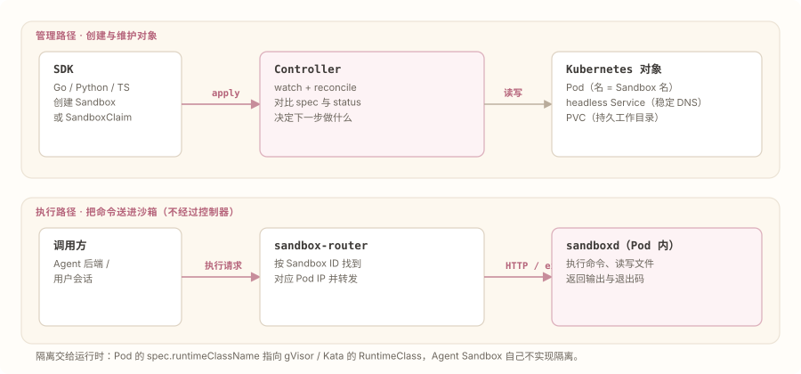
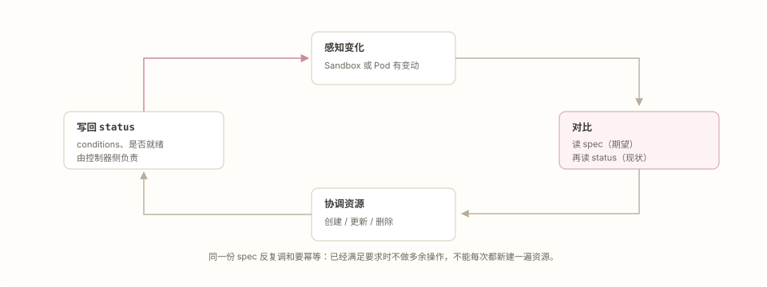
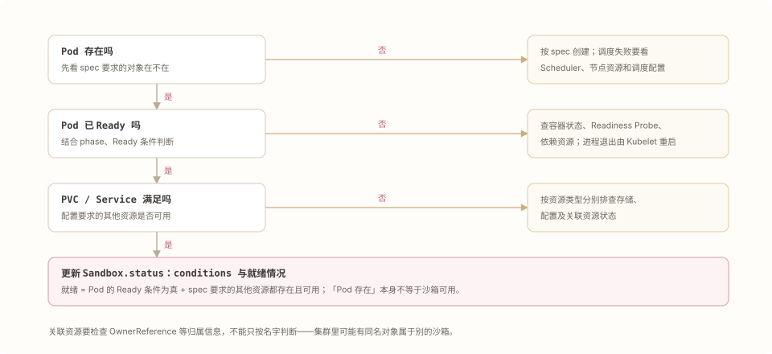
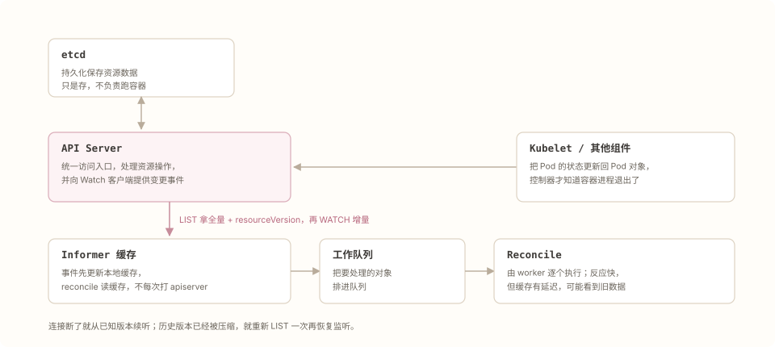
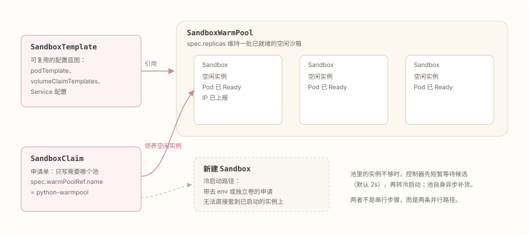
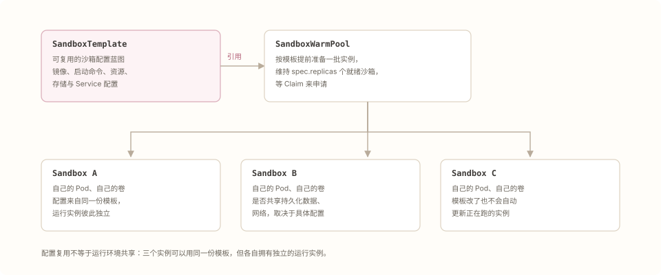
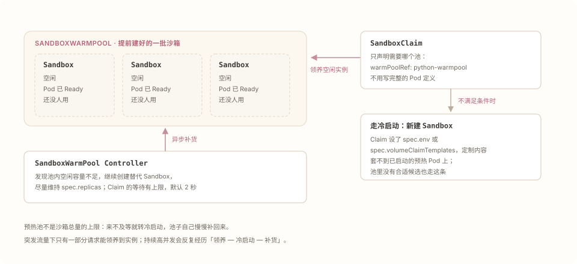
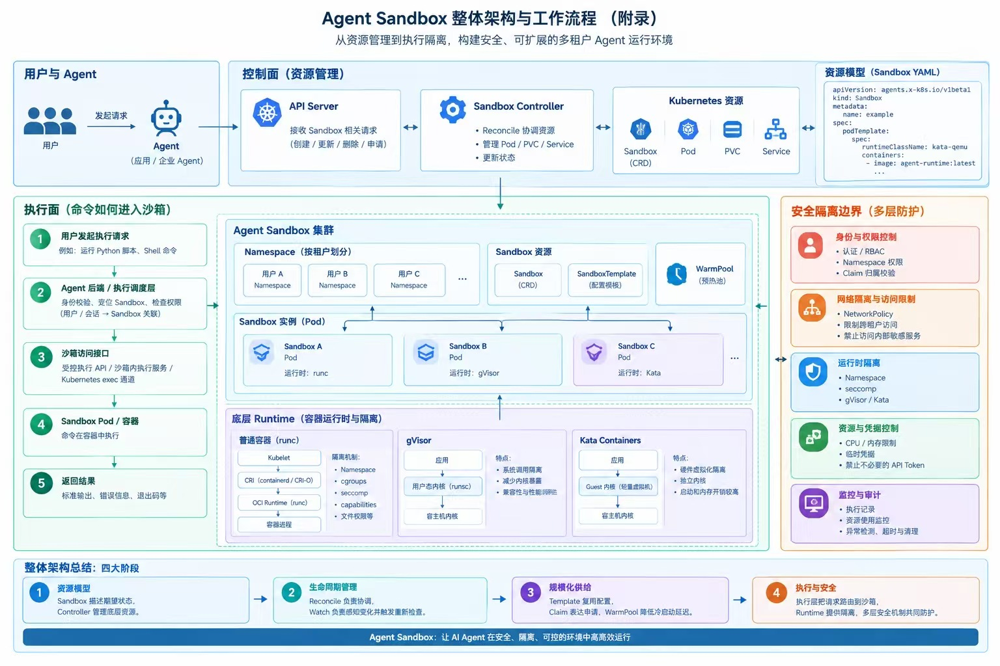

## 1 定义

Agent Sandbox 是一个 **Kubernetes 控制器(Operator)**,提供一种名为 **`Sandbox`** 的自定义资源:**有状态、单实例、由单个 Pod 承载、拥有稳定身份(网络 + 持久存储)的工作负载**,可挂起/恢复、可到期清理、可预热池秒级分配。可理解为"**跑在 K8s 上的轻量级单容器虚拟机**"。

* 解决的问题：Deployment(无状态多副本)、StatefulSet(编号副本)、裸 Pod(一次性无身份)都不适合"一个有身份、有状态、要隔离的沙箱"。
* 典型场景：AI agent 执行不可信代码、RL/评测、notebook、云开发环境。
* 一句话定位：管理层只负责声明式地创建与维护对象；真正的隔离交给运行时(gVisor/Kata)，连通交给数据面(router/sandboxd)。

```
      客户端                │        控制面(本项目核心)                 │          数据面 / 运行时
 ┌──────────────────┐      │  ┌──────────────────────────────────┐  │   ┌───────────────────────────┐
 │ Go/Python/TS SDK │      │  │ Controller(大脑):watch+reconcile  │  │   │ sandbox-router(按ID路由)   │
 │ 创建 Sandbox/Claim│──────┼─▶│  Sandbox(核心)                    │──┼▶  │ sandboxd(Pod内:执行/文件)  │
 └──────────────────┘      │  │  Template/Claim/WarmPool(扩展)    │  │   │ RuntimeClass→gVisor/Kata  │
                           │  └───────────────┬──────────────────┘  │    │   (真正的隔离)             │
                           │                  │ 建/维护标准对象        │   └───────────────────────────┘
                           │                  ▼                      │
                           │       Pod + headless Service + PVC │
```


## 2 整体架构和沙箱资源模型

Agent Sandbox 并不是另起炉灶实现一套容器系统，而是在 Kubernetes 之上增加一层专门管理沙箱生命周期的抽象。

普通 Kubernetes 资源主要提供 Pod、Service、PVC 等基础能力；Agent Sandbox 则引入 `Sandbox`这样的自定义资源，让用户可以直接描述“我需要一个什么样的沙箱”，再由控制器负责把这个声明落实为实际运行的资源。

所以实际上，我们需要理解这三个问题：

1. `Sandbox` 如何描述期望的沙箱？ **沙箱的状态是"本地的、不共享的、跨请求连续的"**
2. Controller 如何把这份描述变成实际运行的资源？ ---  deployment/reconcile为pod分配资源，schedule能将pod分配给node
3. Controller 如何判断沙箱是否已经达到预期状态？ ---  reconcile，比较spec（期望状态）和status（控制器观察的状态）


### 2.1 Sandbox运行链路

首先看sandbox的运行链路和基本概念：

* CRD（CustomResourceDefinition）：扩展 Kubernetes API，定义 `Sandbox`这种自定义资源类型。
* Controller：持续观察资源变化，负责协调底层资源。
* Reconcile：比较期望状态与实际状态，通过创建、更新等操作，使实际状态逐步符合预期。

> 对k8s有基本了解的话，容易发现deployment和reconcile都是对于pod的期望状态和实际状态进行更新。但 reconcile本身属于Sandbox 和 Deployment 共同的底层机制。那问题来了，为什么不直接去掉depolyment，统一交给sandbox管理？
> 事实上，完全是可以这么做的。
> 我们先要确立，沙箱需要：**单例 + 稳定名字 + 挂起时删 pod 但保留 PVC/身份 + 到期策略 + 细分 conditions + 领养预热 pod。**而Deployment 的期望是"N 个可互换的匿名副本"，给 pod 起随机后缀名(`xxx-7d9f-abcde`)→ 没有稳定身份，所以1个svc对应1个deployment确认身份。
> 在[agent sandbox](https://github.com/kubernetes-sigs/agent-sandbox)设计中，采用裸pod：
> 直接**绕过 Deployment，**把 Pod 名直接设成 Sandbox 名,身份和生命周期完全握在自己的 reconcile 里。类似于自己造一台贴合"有状态单例"的引擎,费力但语义最干净、规模最省；
> 但在**微云智能体管理平台**的沙箱设计中，
> 每个沙箱 = 一个单副本 Deployment(`DEFAULT_REPLICAS=1`,挂起时 `STOP_REPLICAS=0`,见 `KubeDeploymentService`)。它复用了 Deployment controller 现成的 reconcile 自愈(pod 挂了,ReplicaSet 自动重建)。
> 所以风险在于：如果未来沙箱数量继续涨、或对"稳定身份 / 至多一个"要求变高,"单副本 Deployment + 外层控制面"这条路的对象开销和失联双实例风险会逐渐显现，对应线上事故：[【2026-09-14 P3 SWS】微云沙箱集群网络组件异常](https://ku.baidu-int.com/knowledge/HFVrC7hq1Q/HXFtYvbMQj/iM_fdBfZc4/vhx7YYdso5b6Cm?t=mention&mt=doc&dt=doc)（当前根本在于4w+需要一个足以支撑的承载点）
> * **Deployment**:每沙箱 = Deployment + ReplicaSet + Pod = **3 层对象**(+Service)。10000 沙箱 = 30000+ 对象,apiserver/etcd 和 Deployment/RS 控制器都要处理。
> * **Deployment**:语义是"**至少 N 个**",节点失联会**果断在别处重建**新 pod → 可能出现"旧 pod 可能还活着 + 新 pod"**短暂并存**。对有状态(尤其微云用 RWX 共享卷)有**双实例/脑裂**风险。
>
* Sandbox：沙箱的管理抽象，不等于 Pod 本身。包括metadata：对象身份与元信息，spec：用户期望的配置 和 status：控制器观察到的状态三部分。




针对Sandbox 资源定义与 YAML 格式，Kubernetes 资源通常包含三个核心部分：

* `metadata`：资源身份与元信息，如名称、命名空间。
* `spec`：用户声明的期望配置。
* `status`：控制器反馈的实际状态与就绪情况。

```
apiVersion: agents.x-k8s.io/v1beta1
kind: Sandbox
metadata:
  name: python-sandbox
spec:
  podTemplate:
    spec:
      containers:
        - name: python
          image: python:3.12
          command: ["sh", "-c", "sleep 3600"]
          resources:
            requests:
              cpu: "500m"
              memory: "512Mi"
            limits:
              cpu: "1"
              memory: "1Gi"
```
该示例声明了一个使用 Python 镜像、具有指定 CPU 和内存配置的沙箱。podTemplate 描述底层 Pod 的运行配置；示例中的 sleep 3600 仅用于维持容器运行，不代表实际 Agent 执行逻辑。


## 3 沙箱生命周期与Controller机制

> Sandbox 声明期望状态 → Controller 执行 Reconcile → 检查并协调 Pod、PVC、Service → 判断资源是否就绪 → 更新 Sandbox.status → Watch 感知变化并再次触发调和。
> Agent Sandbox 并不是简单地创建一个 Pod，而是通过 Kubernetes Controller 持续协调 Sandbox 及其关联资源，使实际运行状态尽可能符合用户声明的期望状态。

### 3.1 Controller 与 Reconcile：如何管理沙箱

Agent Sandbox 并不是创建一次 Pod 就结束，而是通过 Kubernetes Controller 持续协调实际资源，使其尽可能符合 Sandbox.spec 声明的期望状态。

* Controller：负责管理 Sandbox 及其关联资源。
* Reconcile（调和）：读取当前状态，对比期望状态，执行必要的创建、更新、删除等操作。
* 幂等性：同一调和逻辑重复执行，不应不断创建重复资源；已经满足要求时，应尽量不做多余操作。


Sandbox YAML 描述的是用户的期望配置，控制器再根据这些配置协调实际资源。
例如：

* spec.podTemplate：描述沙箱 Pod 的模板，包括容器镜像、启动命令、资源限制等。
* 存储相关模板或配置：声明需要的持久化存储，具体是否创建 PVC 取决于实际配置和控制器逻辑。
* Service 相关配置：控制是否需要为沙箱提供相应的网络访问方式。

因此，声明资源不等于资源已经创建成功，创建成功也不等于沙箱已经可用。
控制器通常还需要判断资源是否已经存在、是否属于当前 Sandbox，以及现有配置是否满足要求。对于关联资源，不能只根据名称判断归属，还需要检查 OwnerReference 等关联信息，避免误处理其他沙箱的资源。


### 3.2 资源状态与异常处理：如何判断沙箱是否可用

Sandbox 的就绪状态不能仅通过“Pod 是否存在”来判断，而要结合 Pod 的运行状态、Ready 条件，以及配置要求的其他资源进行综合判断。

（1）资源检查流程


（2）常见异常及处理层次

| 异常情况            | 主要处理机制                                                 |
| :------------------ | :----------------------------------------------------------- |
| 容器进程退出        | Kubelet 根据容器状态和重启策略尝试重启                       |
| Pod 调度失败        | Kubernetes Scheduler、节点资源和相关调度配置共同影响处理     |
| Pod 被删除          | Controller 观察变化并触发 Reconcile，再根据 Sandbox 生命周期规则决定后续操作 |
| Pod 未就绪          | 检查容器状态、Readiness Probe、依赖资源等原因                |
| PVC 或 Service 异常 | 根据资源类型检查存储、配置及关联资源状态                     |

这里有一个重要区别：重新调和不等于自动重建所有异常资源。

例如，容器进程退出时，Kubelet 可能直接重启容器，不需要 Sandbox Controller 重新创建 Pod；如果 Pod 被删除，控制器是否重新创建，则要看该 Sandbox 的生命周期规则与具体实现。对于配置错误、资源不足等问题，即使控制器反复调和，也不一定能自行修复。


### 3.3 API Server 与 Watch：系统如何感知资源变化

Kubernetes 不是靠 Controller 定时扫描所有 Pod 来维持状态，而是主要通过 Watch 事件机制触发调和。
这里需要区分三个组件的职责：

* etcd：持久化保存 Kubernetes 资源数据。
* API Server：提供统一的资源访问入口，处理资源操作，并向 Watch 客户端提供变更事件。
* Controller / Informer：订阅相关资源的变化，维护缓存，将需要处理的对象加入工作队列，再执行 Reconcile。


Watch 通常配合 `LIST` 与 `metadata.resourceVersion` 使用：客户端先通过 LIST 获取当前资源及其版本，再从对应版本开始 WATCH 后续变化。发生连接中断时，可以尝试从已知版本继续监听；如果历史版本已经不可用，则需要重新 LIST 并恢复监听。

此外，Watch 监听的是 Kubernetes 资源对象的变化，而不是直接监控容器内部的每个进程。比如容器进程退出后，Kubelet 会处理容器状态，并将相应状态更新到 Pod 对象；随后，Controller 才能通过资源变化获知情况并重新调和。


## 4 Template、Claim 与 WarmPool

该部分的核心在于理解 Agent Sandbox 如何从“管理一个沙箱”扩展到“为大量 Agent 用户提供沙箱”。这里先建立一个重要认知：模**板解决配置复用，Claim 解决申请与供给的解耦，WarmPool 解决冷启动延迟**。三者是不同层面的抽象，不能简单理解成三个必然串行执行的步骤。


### 4.1 Sandbox Template 模型如何解决配置服用

`SandboxTemplate`就是一个可复用的沙箱配置蓝图。官方 Quickstart 将其作为创建沙箱前的基础配置资源，供 WarmPool 等机制引用。可按照下图理解。


当然，配置复用不等于运行环境共享。三个实例可以使用同一份模板，但各自拥有独立的运行实例；是否共享持久化数据、网络或其他资源，则取决于具体配置。

Question 1：模板是不是改一次，所有沙箱就会自动更新？

当然不是。模板被修改后，已有沙箱是否自动更新，取决于项目定义的模板版本识别、控制器协调和更新策略。即使某种版本支持滚动更新，也不意味着任何字段变化都可以无损地应用到正在运行的沙箱。基本是结合根据模版本身的定义和沙箱本身配置，运行情况等逐步更新。

Question 2：模版更改后，怎么确立所有沙箱均更新完成？

正常情况下，关键在于版本一致性。例如，可以为模板内容计算一个 `templateHash`，创建沙箱时记录它使用的哈希。更新模板后，将目标哈希从 `H1`变为 `H2`，再统计每个目标实例是否使用 `H2`且已经 Ready。

但有一个实际限制：Agent Sandbox 当前不能简单地依靠 WarmPool 的 `readyReplicas`就证明所有实例已使用最新模板。项目中关于可靠滚动更新结果的 Issue #1327 指出，现有状态统计可能把旧模板创建的 Ready 实例也计算进去；该 Issue 还将按模板哈希统计更新后的 Ready 副本、设置更新超时并明确报告失败，列为待完善的能力。

因此，如果你在上层系统中需要可靠的“更新完成”信号，应该确认所用版本是否支持这些状态；如果没有，就需要额外做版本追踪与核验，而不能直接把 WarmPool Ready 当作全量更新成功。


### 4.2 SandboxClaim 与 SandboxWarmPool：如何申请和快速分配沙箱

`SandboxClaim`可以理解为一份沙箱申请单。调用方不必直接管理底层 Pod 的创建细节，而是声明需要什么沙箱、使用哪个 WarmPool 等信息。控制器负责处理申请，并将分配结果反映到 Claim 的状态中。比如：

```
# 申请使用名为 python-warmpool 的预热池。它并没有在 YAML 中直接编写完整的 Pod 定义。
apiVersion: extensions.agents.x-k8s.io/v1beta1
kind: SandboxClaim
metadata:
  name: user-a-claim
spec:
  warmPoolRef:
    name: python-warmpool
```
`SandboxWarmPool`的思路是：把一部分创建工作提前做完，维持一批已经准备好的沙箱实例，等待 Claim 申请。工作方式可以如下图：


注意预热池中存在可用实例，不代表所有 Claim 都一定能直接复用它。根据项目当前的性能调优文档，Claim 如果设置了 spec.env 或 spec.volumeClaimTemplates，就会走冷启动路径，而不是直接接管已经运行的预热实例。这是因为这些定制内容无法直接应用到已经启动的预热 Pod 上。相对而言，spec.additionalPodMetadata 可以应用于被接管的实例，不会仅因为设置了它就强制冷启动。

这体现了一个很重要的工程权衡：

* 复用预热实例：分配速度快，但实例必须满足 Claim 的配置要求。
* 按需创建实例：灵活性更高，可以根据申请定制运行环境，但需要承担启动成本。

因此，设计 Agent 沙箱产品时，不能只看预热池有多少副本，还要考虑请求的配置是否兼容预热实例。预热池中存在可用实例，不代表所有 Claim 都一定能直接复用它。

Question 1：当外部需要的sandbox数量比预热池数量多时，agent sandbox和预热池分别会怎么做？

预热池不是系统能够创建的沙箱总量上限。预热池不足时，Agent Sandbox 可以在等待短暂的预热候选期后，转向冷启动创建；WarmPool Controller 则异步补充预热实例。

|               组件                |                           主要行为                           |
| :-------------------------------: | :----------------------------------------------------------: |
|      SandboxClaim Controller      | 尝试寻找可分配的预热 Sandbox；没有合适候选时，根据候选等待策略转向冷启动创建 |
|        Sandbox Controller         | 协调新 Sandbox 的底层资源，例如创建 Pod，并根据实际状态更新就绪情况 |
|    SandboxWarmPool Controller     | 发现池内空闲容量不足后，继续创建替代 Sandbox，尽量维持 `spec.replicas` |
| Kubernetes Scheduler / Kubelet 等 | 负责后续 Pod 调度、容器启动等工作；资源不足时，Pod 可能无法及时运行 |

当前仓库配置文档中，`--sandbox-claim-warm-candidate-grace-period`的默认值为 2 秒：新 Claim 在等待预热候选实例报告 Pod IP 时，会短暂等待；如果到期仍没有合适候选，就会转向冷启动创建。这个时间是候选等待策略，不是保证整个沙箱在 2 秒内创建成功。

如果存在异常场景，比如：

* 突发流量：短时间内有大量 Claim 到来。预热池可以优先满足一部分请求，其余请求进入冷启动路径；预热池同时补充容量。
* 持续高并发：长期请求量高于预热池的可用容量。系统会反复经历预热分配与冷启动，整体延迟取决于冷启动速度、集群资源和控制器处理能力。如果需要减少冷启动，就应评估增加预热副本、动态扩缩容或设置请求并发上限。

此外，如果节点没有足够的 CPU、内存或其他资源，即使进入冷启动路径，也不代表 Pod 一定能马上调度成功。WarmPool 的补充过程同样可能受资源不足影响。官方配置文档还提供了批量创建、控制器并发和不可调度实例重新检查等参数，以便在高负载下调整行为。


## 5 执行链路、运行时与安全边界

当用户让 Agent 执行一条命令时，这条命令究竟是怎么进入沙箱的？Pod 为什么能隔离不同用户？如果普通容器隔离不够，又该如何选择 gVisor、Kata Containers 等 Runtime？

### 5.1 Sandbox 的执行路径

Agent Sandbox 的管理路径与执行路径是两个不同的部分。管理路径负责创建和维护沙箱资源，执行路径负责将 Agent 的命令发送到正确的沙箱中执行，并将执行结果返回给调用方。

当用户要求 Agent 执行 Python 脚本或 Shell 命令时，典型流程是：用户向 Agent 发起请求，Agent 后端根据用户身份、会话信息和 Sandbox 关联关系找到目标沙箱，然后通过受控执行 API、沙箱内的执行服务或 Kubernetes exec 通道发送命令。命令最终在 Sandbox 对应的 Pod 容器中执行，执行结果再返回 Agent 后端。

```
用户 / Agent
     │ 执行请求
     ▼
Agent 后端 / 执行调度层
     │ 身份校验、定位 Sandbox、检查权限
     ▼
沙箱访问接口
     │ 发送命令
     ▼
Sandbox 对应的 Pod / 容器
     │
     ▼
执行命令并返回输出、错误信息和退出码
```
其中，Sandbox Controller 主要负责资源生命周期管理，不需要参与每一次命令执行。它通过 Reconcile 协调 Sandbox、Pod 等 Kubernetes 资源；执行调度层则负责用户请求与具体沙箱之间的关联。沙箱创建成功不等于用户自动获得执行权限，因此还需要进行身份认证、访问鉴权、执行超时控制、并发限制和操作审计。上述流程是典型架构示意，具体执行接口取决于 Agent Sandbox 的集成方式。


### 5.2 Runtime：容器运行机制与隔离方式

Agent Sandbox 本身不实现一个全新的操作系统内核，而是通过 Kubernetes 管理沙箱工作负载，并利用底层容器运行时提供执行和隔离能力。普通 Kubernetes 容器通常由 containerd 或 CRI-O 等实现 CRI 接口的运行时管理，再通过 `runc`等 OCI Runtime 创建容器进程。典型链路为：

```
Kubelet
   │
   ▼
CRI Runtime（containerd / CRI-O）
   │
   ▼
OCI Runtime（runc）
   │
   ▼
容器进程
```
普通容器主要依靠 Linux Namespace、cgroups、seccomp、Linux capabilities 等机制进行隔离和资源控制。其中，Namespace 隔离进程、网络和挂载点等视图；cgroups 控制或统计 CPU、内存等资源；seccomp 限制系统调用。普通容器通常仍与宿主机共享 Linux 内核，因此容器隔离并不等于拥有独立内核。

对于运行不可信 Agent 生成代码的场景，可以考虑更强的隔离运行时。gVisor通过用户态内核处理应用的大量系统调用，减少工作负载直接接触宿主机内核的机会，但需要评估系统调用兼容性和性能。Kata Containers通常将工作负载运行在轻量虚拟机中，使其使用独立的 Guest 内核，增加硬件虚拟化隔离边界，但也会带来额外的启动和内存开销。

| 对比项       | 普通容器（runc）   | gVisor             | Kata Containers             |
| :----------- | :----------------- | :----------------- | :-------------------------- |
| 核心隔离机制 | Linux 内核隔离机制 | 用户态内核         | 轻量虚拟机、独立 Guest 内核 |
| 主要优势     | 兼容性好、开销较低 | 增加系统调用隔离层 | 提供更强的内核隔离边界      |
| 主要权衡     | 与宿主机共享内核   | 兼容性与性能       | 启动、内存和虚拟化开销      |

Agent Sandbox 可以通过 Pod 配置中的 `runtimeClassName`指定运行时，例如 `kata-qemu`。但这要求集群已经配置相应的 RuntimeClass 和底层运行环境，仅修改 YAML 并不会自动安装或启用 Kata。运行时的选择应根据威胁模型、工作负载兼容性、资源成本和集群环境综合决定，而不是简单地认为某一种运行时适合所有场景。


### 5.3 安全隔离边界与多租户防护

Agent Sandbox 的核心目标之一是为不同 Agent 任务提供相对独立的执行环境，但创建独立 Sandbox 或 Pod 并不意味着整个系统已经具备完整的多租户安全能力。安全设计需要同时考虑身份权限、网络访问、运行时隔离、资源控制、凭据管理和操作审计。

Namespace 可以对 Kubernetes 资源进行逻辑分组，并配合 RBAC 限制用户和服务账号的操作权限，但 Namespace 本身不会自动隔离所有网络流量，也不会为每个租户创建独立内核。因此，多租户环境通常还需要结合 NetworkPolicy 限制沙箱之间的通信，使用安全的 Runtime 降低内核攻击风险，并通过 CPU、内存限制及配额控制资源消耗。

另一个重要问题是凭据安全。沙箱中的代码可能尝试访问进程有权读取的环境变量、文件和服务接口，因此不应向沙箱暴露不必要的 Kubernetes ServiceAccount Token、云平台高权限密钥或其他租户的凭据。对于不可信代码，应尽可能限制其 Kubernetes API 访问权限，并控制网络出站访问，避免沙箱访问内部敏感服务或云元数据接口。同时，还需要设置执行超时、日志审计、异常检测和资源清理机制，防止恶意或失控的 Agent 长时间占用资源。

整体上，可以将安全防护理解为多个层次的组合：

```
身份与权限控制
       ↓
网络隔离与访问限制
       ↓
容器 / 虚拟化运行时隔离
       ↓
资源限制与凭据保护
       ↓
监控、审计与异常清理
```
这些机制分别解决不同类型的风险，不能相互替代。Namespace 主要解决资源组织和权限边界问题，NetworkPolicy 主要限制网络通信，gVisor 和 Kata 强化运行时隔离，而凭据管理和审计则用于减少敏感信息泄露与追踪异常行为。


## 附录




## 参考

[agent-sandbox](https://github.com/kubernetes-sigs/agent-sandbox)
