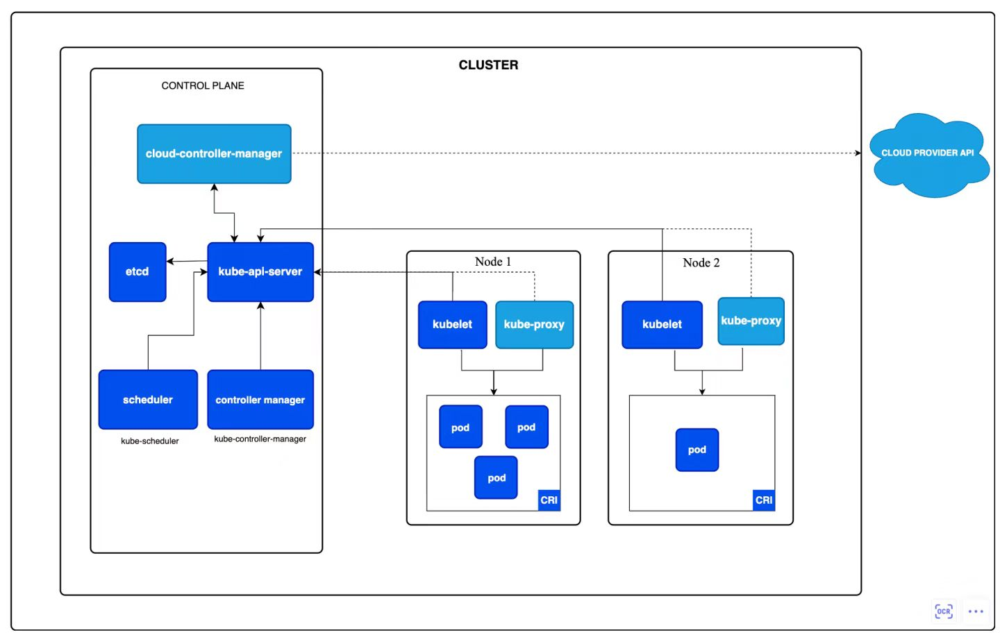
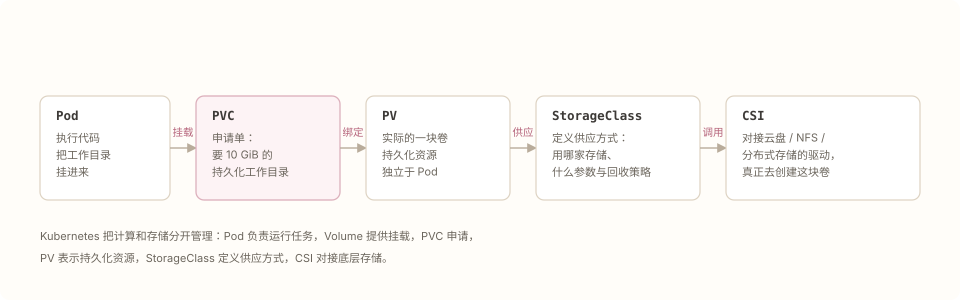
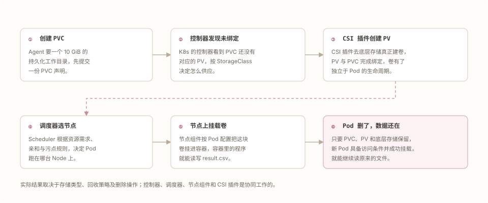
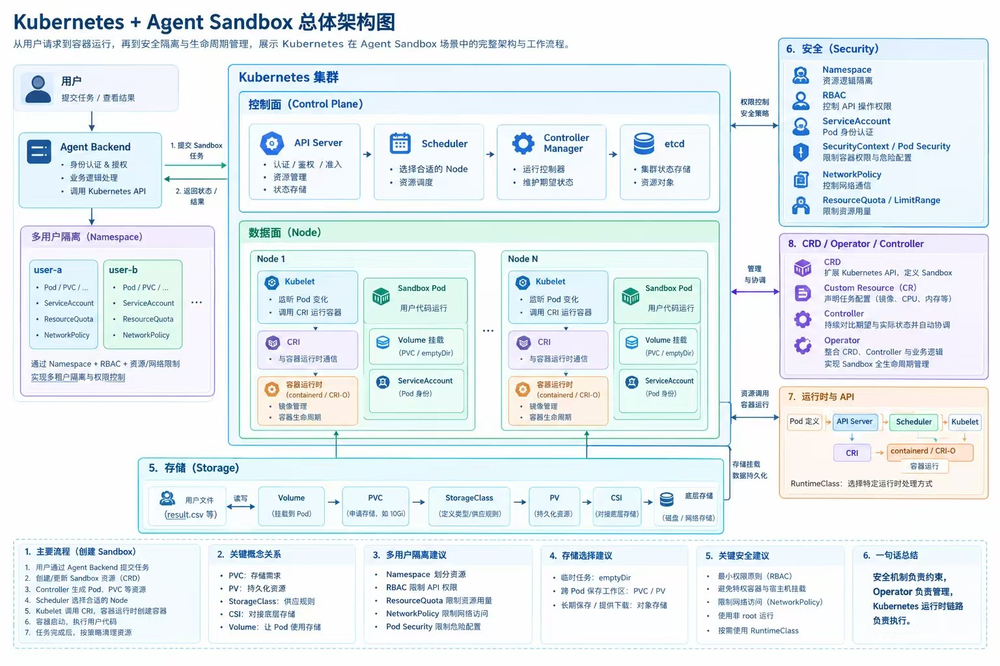

Kubernetes集群由一个控制平面和一组运行容器化应用程序的工作机器（称为节点）组成。每个集群都需要至少一个工作节点才能运行Pod。


## 1 背景和概念

实际生产环境中，考虑到：

* **应用**后端按业务功能或技术职责拆分成多个**服务**，例如用户、订单、消息、网关等。服务边界清晰后，可以独立开发、部署和扩容；某个服务出问题，也尽量不拖垮整个系统。
* 服务有多个**副本**，副本分布在不同机器上，通过负载均衡分摊流量，避免一台机器承担全部负载；机器故障或维护时，也能把容器迁移或重新调度到其他机器。
* **容器**共享底层服务器的 CPU、内存和网络资源。调度系统会把容器分散到多台**机器**上，避免一台机器承担全部负载；机器故障或维护时，也能把容器迁移或重新调度到其他机器。

K8s就是其中的调度系统，实现`自动部署，自动扩容，自动重启，负载均衡，服务发现，滚动更新`。


## 2 产品结构

###  2.1 核心要点

```
K8s Cluster 整个 K8s 系统
│
├── Node 是一台真正运行工作负载的机器 （物理服务器，虚拟机，云服务器均可）
│    ├── Pod 最基本的运行单位，通常里面放一个或几个容器
│    │    └── Container
│    │           └── 后端程序
│    └── Pod
│
├── Deployment 负责管理 Pod
│
└── Service 负责让其他服务能够稳定地找到这些 Pod，并进行流量分发
```


### **2.2 从后端流程看**

> 代码 → 镜像 → 容器 → Pod → K8s 管理 → Service 暴露 → CI/CD 自动部署
> 当你写了一个Java/Python/C++ 后端`my-server`，先构建 Docker 镜像`my-server:v1`，然后交给K8s，

然后通过Development为你创建三个pod，理解为创建了三个副本

```
Deployment
      ↓
创建 3 个 Pod
      ↓
┌────────────┐ ┌────────────┐ ┌────────────┐
│ Pod 1      │ │ Pod 2      │ │ Pod 3      │
│ my-server  │ │ my-server  │ │ my-server  │
└────────────┘ └────────────┘ └────────────┘
```
当用户存在大量请求涌入时，Service可以将这个后端服务的请求分流到多个pod中，保证负载均衡

```
             用户
              ↓
           Service
          ↙   ↓   ↘
       Pod1  Pod2  Pod3
```
即使访问量突然增加时，K8s也可以自动扩容pod从3到10。


## 3 技术架构

Kubernetes 集群主要分为 **控制面（Control Plane）** 和 **节点面（Worker Node）** 两部分：

```
Kubernetes Cluster
│
├── Control Plane —— 负责管理、调度、维护集群状态
│   ├── API Server
│   ├── etcd
│   ├── Scheduler
│   └── Controller Manager
│
└── Worker Node —— 负责真正运行 Pod / Container
    ├── Kubelet
    ├── Container Runtime
    ├── CNI
    └── kube-proxy
```


### 3.1 控制面 Control Plane

控制面可以理解为 Kubernetes 的大脑，主要负责接收用户请求、保存集群状态、进行资源调度以及自动维持集群的期望状态。

API Server

* Kubernetes 集群的统一入口。
* kubectl、各种 SDK、Agent 等都可以通过 Kubernetes API 与集群交互。
* 负责认证、鉴权、请求处理以及 Kubernetes 对象的管理。
* 可以理解为：“集群的大门”。

etcd

* Kubernetes 使用的分布式键值数据库。
* 保存 Pod、Node、Deployment 等 Kubernetes 对象以及集群状态。
* 本身不负责运行容器，只负责保存和提供集群状态。
* 可以理解为：“集群的状态数据库 / 账本”。

Scheduler

* Kubernetes 的调度（Scheduling）主要负责决定 Pod 应该运行在哪个 Node 上。
* Scheduler 会根据 Pod 的 **Requests/Limits** （比如CPU，GPU，memory等）判断资源需求，再结合 **NodeSelector、Affinity、Taint/Toleration** 等规则筛选合适的 Node，同时可以通过 **Pod Affinity/Anti-Affinity 和 Topology Spread** 控制 Pod 之间的分布关系，最终选择一个合适的 Node。
* 简单来说：**Requests/Limits 决定“需要多少资源”，Affinity 等决定“想去哪里”，Taint/Toleration 决定“能不能去”，Scheduler 最终决定“具体去哪台 Node”。**

Controller Manager

* 内部运行多个 Controller。
* Controller 持续观察集群当前状态，并与用户声明的期望状态进行比较。
* Develpoment如果发现服务预计的pod数量和实际不一致，就让Controller Manager执行相应操作进行纠正。
* 可以理解为：“自动纠偏系统”。


### 3.2 节点面 Worker Node

Worker Node 可以理解为 Kubernetes 的“执行层”，真正负责运行 Pod 和其中的容器。

Kubelet

* 每个 Worker Node 上运行的 Kubernetes Agent。
* 根据 API Server 中记录的 Pod 配置，负责管理本机 Pod 的生命周期。
* 会与 Container Runtime、CNI 等组件协作。
* 可以理解为：“节点上的执行者 / 管家”。

Container Runtime

* 真正负责创建、启动、停止容器。
* 常见实现有 containerd、CRI-O。
* Kubelet 通常通过 CRI（Container Runtime Interface） 与其交互。

CNI

* 负责 Pod 的网络配置，例如分配 IP、建立网络连接等。
* 常见实现有 Calico、Cilium、Flannel。
* 可以理解为：“Pod 的网络系统”。

kube-proxy

* 主要负责 Kubernetes Service 相关的流量转发。
* 传统上通过 iptables、IPVS 等机制实现 Service 到后端 Pod 的流量转发。
* 现代一些网络方案可以替代 kube-proxy 的部分甚至全部功能。


## 4 k8s网络

k8s网络主要解决的问题为：① Pod内部通信：Pod ↔ Pod；② 集群内访问：外部 / Pod ↔ Service ↔ Pod；③ 外部流量访问：Pod ↔ 外部网络。

### 4.1 整体结构

```
           Kubernetes Cluster
┌─────────────────────────────────────────┐
│   Pod A ───────────────→ Pod B          │
│      │                    ↑             │
│      │                    │             │
│      ↓                    │             │
│   Service ────────────────┘             │
│      ↑                                  │
│      │                                  │
│   DNS 根据名字找到 Service                │
│                                         │
│   CNI：负责 Pod 网络                     │
│   kube-proxy：负责传统 Service 转发       │
└─────────────────────────────────────────┘
```
核心组件：

* Pod Network：提供 Pod 之间通信的基础网络，即使 Pod 位于不同 Node 上，也能够通过网络进行通信。
* CNI：负责配置 Pod 网络，包括 IP 分配、网卡和路由等，常见实现有 Calico、Cilium、Flannel。
* Service：为一组 Pod 提供稳定的访问入口，通过 Label Selector 找到对应的 Pod，避免 Pod IP 变化影响访问。
* DNS：负责服务名称解析，使应用可以通过 Service 名称访问其他服务，而不必记住 IP 地址。
* kube-proxy：传统上负责配置 Service 到后端 Pod 的流量转发规则。
* NetworkPolicy：控制 Pod 之间以及 Pod 与其他网络之间允许通过的流量，具体执行通常依赖 CNI 实现。


### 4.2 实际示例：Agent Sandbox 访问数据库

假设 Agent 创建了一个 Sandbox Pod 执行 Python 代码，需要连接数据库保存执行结果。集群中有以下资源（IP 均为虚拟示例）：

| 资源             | 地址（网络ip由CNI配置） | 作用         |
| :--------------- | :---------------------- | :----------- |
| Sandbox Pod      | `10.244.1.10`           | 执行代码     |
| Database Service | `10.96.0.100:5432`      | 稳定访问入口 |
| Database Pod A   | `10.244.2.20:5432`      | 数据库实例   |
| Database Pod B   | `10.244.2.21:5432`      | 数据库实例   |

通信流程：

```
Agent Sandbox Pod
IP: 10.244.1.10
│
│ ① 程序连接 db-service:5432
▼
Kubernetes DNS（如 CoreDNS）
│
│ ② 查询服务名称对应的地址
│    db-service → 10.96.0.100
▼
Database Service
IP: 10.96.0.100:5432
│
│ ③ 通过转发规则 比如Label 选择后端 Pod
│    （传统架构通常由 kube-proxy 配置）
▼
┌───────────────┐
│ Database Pod A│ 10.244.2.20:5432
│ Database Pod B│ 10.244.2.21:5432
└───────────────┘
```


## 5 k8s存储

Kubernetes 将计算和存储分开管理。Pod 负责运行任务，Volume 提供存储挂载，PVC 申请存储，PV 表示持久化资源，StorageClass 定义供应方式，CSI 对接底层存储。这样就能根据需要，让文件的生命周期独立于 Pod 的生命周期。

### 5.1 存储产生原因

Agent Sandbox 执行代码后会产生文件，例如 `result.csv`。如果文件只保存在容器可写层或临时卷中，Pod 删除后数据可能丢失，因此需要根据数据的生命周期选择存储方式，对于不同的需求存在不同的方案：

| 需求                       | 适合的方案 | 数据生命周期                       |
| :------------------------- | :--------- | :--------------------------------- |
| 临时文件，中间数据         | `emptyDir` | 通常随 Pod 删除而清理              |
| 需要持久保存的文件         | PV/PVC     | 可以独立于 Pod 生命周期保留        |
| 供其他系统下载、共享的文件 | 对象存储等 | 由对象存储的生命周期和清理策略决定 |

### 5.2 核心结构

当Agent需要为任务申请一个 10 GiB 的持久化工作目录，整个关系大概为：（实际中K8s的控制器、调度器、节点组件和 CSI 插件会协同工作）



实际中，即使pod被删除，只要 PVC、PV 和底层存储仍然保留，新 Pod 又具备相应的访问条件并成功挂载，就可以继续读取原有文件。实际结果取决于存储类型、回收策略及删除操作。


## 6 其它

### **Kubernetes 安全（Security）**

> Kubernetes 安全主要解决用户权限、容器运行权限和网络访问控制问题。
> Namespace 用于划分不同用户或租户的资源，RBAC 控制用户或 ServiceAccount 能执行哪些 Kubernetes API 操作，SecurityContext 和 Pod Security 用于限制容器权限及危险配置，NetworkPolicy 控制 Pod 之间的网络通信，ResourceQuota 则限制 Namespace 的资源用量。对于多用户 Agent Sandbox，通常通过 Namespace + RBAC + 网络和资源限制实现多层隔离，但 Namespace 本身并不是完整的安全边界。

### **Kubernetes 运行时与 API（Runtime & API）**

> Kubernetes API 提供统一的资源管理入口。
> API Server 接收并处理资源请求，Scheduler 负责为 Pod 选择合适的 Node，Kubelet 负责在节点上落实 Pod 的运行要求。Kubelet 通过 CRI（Container Runtime Interface） 与容器运行时通信，由 containerd 或 CRI-O 等组件负责容器生命周期管理和镜像处理。RuntimeClass 可以让 Pod 选择集群中预先配置的运行时处理方式，以满足不同的隔离或性能需求。整体流程是：创建 Pod → API Server 处理 → Scheduler 调度 → Kubelet 执行 → 容器运行时创建并启动容器。

### **CRD / Operator / Controller**

> Kubernetes 内置了 Pod、Job、Deployment 等资源，但不直接理解 Agent Sandbox 的业务概念。
> 通过 CRD（CustomResourceDefinition） 可以扩展 Kubernetes API，定义 Sandbox 等自定义资源；CR（Custom Resource） 是具体的资源实例，用于声明镜像、CPU、内存等期望配置；Controller 持续对比实际状态与期望状态，并通过创建、更新或清理资源使两者趋于一致；Operator 则将 CRD、Controller 与具体业务逻辑结合，实现自动化管理。对于 Agent Sandbox，Operator 可以统一管理 Sandbox 的创建、状态跟踪、异常处理、重试和资源清理，适合生命周期管理较复杂的场景。

## 附录

k8s结构图


